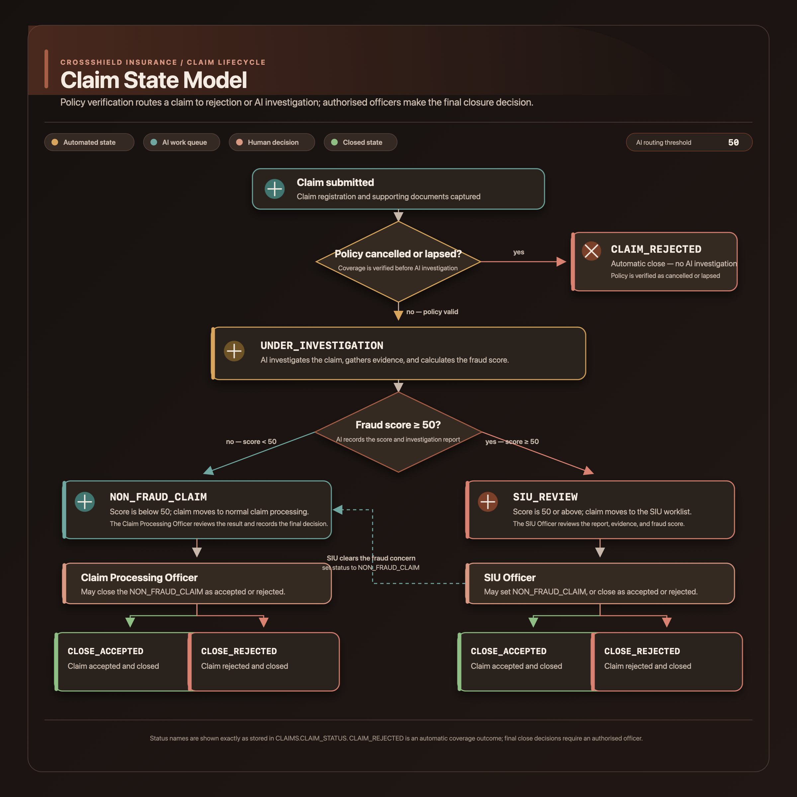
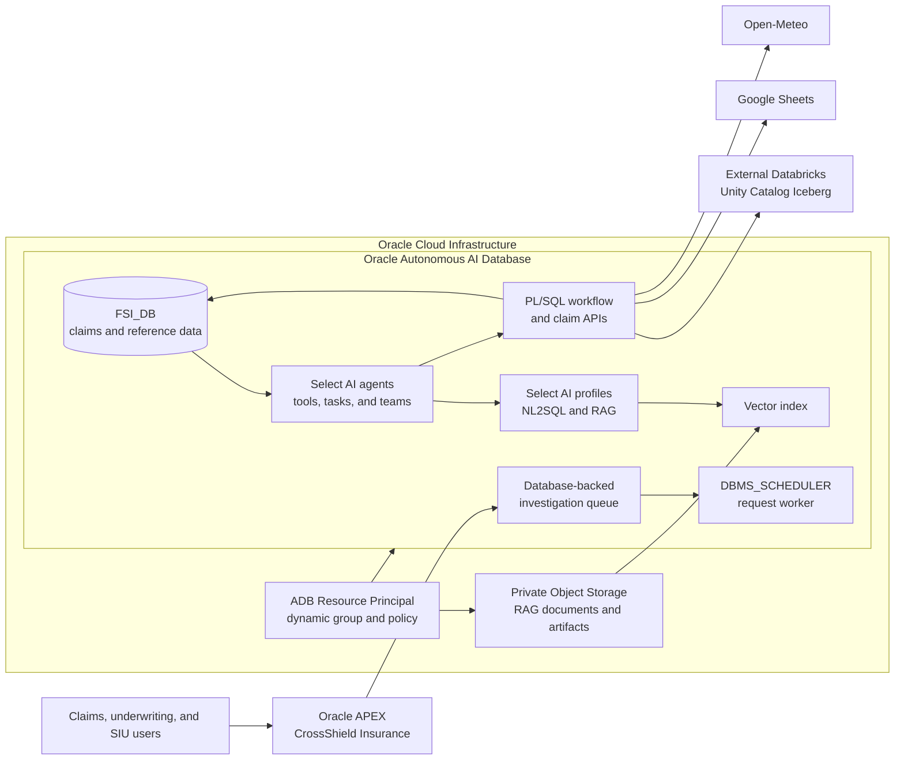
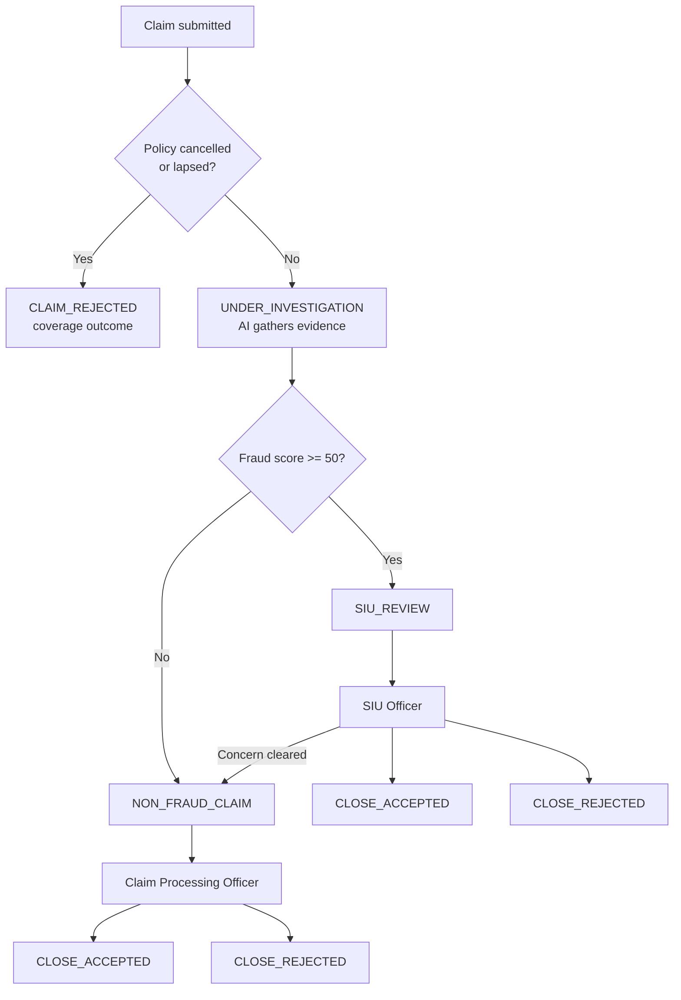

# Oracle Cloud Foundation Terraform Solution - Deploy FSI-AI-Hub CrossShield Insurance demo

## Table of Contents

1. [Overview](#overview)
2. [Deliverables](#deliverables)
3. [Architecture](#architecture)
   1. [Claim lifecycle](#claim-lifecycle)
   2. [Infrastructure mapping](#infrastructure-mapping)
4. [Executing Instructions](#executing-instructions)
   1. [Prerequisites](#prerequisites)
   2. [Important](#important)
   <!-- 3. [Deploy Using Oracle Resource Manager](#deploy-using-oracle-resource-manager) -->
   4. [Deploy Using the Terraform CLI](#deploy-using-the-terraform-cli)
      1. [Repository files](#repository-files)
      2. [OCI Provider Parameters](#oci-provider-parameters)
      3. [Autonomous Database](#autonomous-database)
         1. [Autonomous Database Parameters](#autonomous-database-parameters)
         2. [FSI Schema Parameters](#fsi-schema-parameters)
      4. [LLM settings](#llm-settings)
      5. [RAG and Vector Search](#rag-and-vector-search)
      6. [APEX Application](#apex-application)
      7. [Object Storage](#object-storage)
      8. [Project Settings](#project-settings)
      9. [External Integrations](#external-integrations)
         1. [External Databricks Unity Catalog](#external-databricks-unity-catalog)
         2. [Google Sheets](#google-sheets)
         3. [Open-Meteo](#open-meteo)
         4. [Other runtime configuration keys](#other-runtime-configuration-keys)
      10. [Network and connectivity](#network-and-connectivity)
      11. [Provisioner](#provisioner)
      12. [Running the code](#running-the-code)
      13. [What to do after the deployment](#what-to-do-after-the-deployment)
5. [Runtime Operations](#runtime-operations)
   1. [Investigation queue and APEX](#investigation-queue-and-apex)
   2. [Agent teams](#agent-teams)
   3. [Useful database checks](#useful-database-checks)
6. [Documentation](#documentation)
7. [The Team](#the-team)
8. [Feedback](#feedback)
9. [Known Issues](#known-issues)
10. [Contribute](./CONTRIBUTING.md)

## Overview

CrossShield Insurance demonstrates an AI-assisted motor-claims workflow on Oracle Cloud Infrastructure (OCI). Claims staff use an Oracle APEX application to review claims, investigate evidence, route cases to the appropriate work queue, and record authorized decisions.

Oracle Autonomous AI Database stores the claims data and hosts the workflow logic, Select AI profiles, agents, and RAG index. Terraform creates the OCI resources and configures the database through the SQLcl provisioner. The application can use approved claim data and configured external sources, including an external Databricks Unity Catalog Iceberg catalog.

The fraud score is a triage signal. It does not establish fraud, reject a claim, approve a payment, or replace an authorized claims or SIU decision.

The documentation follows the section hierarchy and deployment-guide style of the published [Fashion-Retail-Hub Terraform solution](https://github.com/oracle-devrel/terraform-oci-oracle-cloud-foundation/tree/main/Live-AI-Hub/reusable-assets/Fashion-Retail-Hub), with infrastructure and application details specific to CrossShield.

## Deliverables

The FSI solution provides:

- Terraform configuration for Terraform CLI in this directory and a separate OCI Resource Manager stack under `resource-manager/`;
- an Oracle Autonomous AI Database instance and wallet used by the SQLcl provisioner;
- a private OCI Object Storage bucket for knowledge-base documents and application-generated artifacts;
- optional ADB Resource Principal IAM resources with access scoped to the target compartment;
- the `FSI_DB` schema, application data, database objects, PL/SQL APIs, and DMP-derived relational SQL;
- Oracle APEX workspace configuration and Application 108 imported from `fsi_apex_export_par_url`;
- Select AI profiles, the RAG vector index, agent tools, tasks, and teams;
- an asynchronous database-backed APEX investigation request queue and worker;
- external-source configuration for Databricks, Google Sheets, Open-Meteo, and other application integrations;
- High-Level Design, Low-Level Design, comparison, and source-deployment documentation under `documentation/`.

The Data Pump file is not imported during deployment. Its required schema definitions and data are represented by ordered SQL files under `modules/provisioner/`.

## Architecture

The solution provisions OCI resources with Terraform, then runs SQL and APEX setup against the database using the generated wallet. External systems remain external: Terraform configures database credentials, network ACLs, and integration settings but does not create the Databricks workspace or Azure storage account.






### Claim lifecycle

The following diagram reflects the supplied CrossShield claim-state model. Policy coverage is shown as the first decision in that model. Fraud-score routing currently uses a fixed threshold of 50 in the database outcome function; authorized claims or SIU officers make the final closure decision.



`CLAIM_REJECTED` represents the coverage outcome in the supplied state model. `CLOSE_ACCEPTED` and `CLOSE_REJECTED` are final human decisions. The Terraform variable `fraud_notification_threshold` configures the notification setting; it does not change the fixed 50-point routing threshold in the current database function.

### Infrastructure mapping

| Component | Terraform or database implementation | Purpose |
| --- | --- | --- |
| Autonomous Database | `module.adb` | Database, wallet, and connection inputs for provisioning. |
| Object Storage | `module.os` | Private bucket for approved knowledge documents and generated artifacts. |
| Knowledge-base files | `module.knowledge_base_files` | Terraform uploads the approved Markdown files from `documentation/`. |
| ADB Resource Principal | `oci_identity_dynamic_group.fsi_adb`, `oci_identity_policy.fsi_adb` | Grants the database the configured Object Storage and Generative AI access. |
| Database setup | `module.provisioner` | Runs schema, data, Select AI, integration, scheduler, and APEX setup. |
| APEX | `fsi_apex_export_par_url` | Imports the current Application 108 export. |
| External data | Runtime configuration and database credentials | Connects to externally managed services; does not provision them. |

## Executing Instructions

### Prerequisites

For Terraform CLI deployment, have the following available:

- an OCI tenancy, target region, and target compartment;
- an OCI user with an API signing key and permissions to manage the required resources in the target compartment;
- Terraform version supported by the OCI provider configuration;
- SQLcl available as the `sql` command;
- Python 3 available as `python3`;
- network access from the Terraform execution environment to OCI and the Autonomous Database;
- OCI CLI available if you plan to destroy the deployment, because the bucket cleanup runs before bucket deletion;
- service credentials and endpoint details for the integrations you want to enable;
- sufficient quota for one Autonomous Database and one Object Storage bucket.

Required OCI provider inputs are `tenancy_ocid`, `region`, `compartment_id`, `user_ocid`, and `fingerprint`, together with either a local `private_key_path` or the PEM content in `oci_private_key_pem`.

Resource Manager uses the files under `resource-manager/`. Its execution environment must support the provisioner's SQLcl commands and have access to the generated database wallet.

### Important

- The deployment region and compartment are inputs. Set `region` and `compartment_id` for the target tenancy; runtime OCI region, compartment, and Object Storage values are derived from those deployment inputs where supported.
- OCI Generative AI model availability varies by region. Confirm model availability before changing `region` or a model variable.
- The bucket access type is validated as `NoPublicAccess`; object URLs and scripts are designed to use authenticated, private access.
- `variables.tf` is the source of Terraform defaults, including the runtime configuration maps. This solution does not require an additional `.tfvars` file. Resource Manager exposes the stack inputs through its schema.
- Password, private-key, connection-string, API-key, and PAR defaults are blank in source. Supply them through protected deployment inputs. Terraform state and Resource Manager job metadata can still contain supplied values; protect them and rotate any credentials previously exposed.
- The current FSI Resource Manager release ZIP is not listed among the repository's published release assets. The Deploy button below opens the OCI Resource Manager stack-creation page; upload the stack package from `resource-manager/` to create the stack.
<!-- 
### Deploy Using Oracle Resource Manager

[](https://cloud.oracle.com/resourcemanager/stacks/create?region=home)

1. Sign in to the OCI Console and select the region in which to create the stack.
2. Click **Deploy to Oracle Cloud** to open Resource Manager's stack-creation flow.
3. Upload the Resource Manager package from this solution's `resource-manager/` directory.
4. Review the stack variables. Set the target tenancy, region, compartment, authentication, database, APEX, and integration inputs.
5. Create the stack, open **Terraform Actions**, and run **Plan**.
6. Review the plan and job requirements. Make any input changes through **Edit Stack**, then run Plan again.
7. When the plan is correct, select **Apply** and review the job log for SQLcl, database setup, Databricks mount, and APEX import results.

Resource Manager currently does not receive an FSI-specific ZIP from the public GitHub release. The button opens the stack flow; it does not fetch or deploy a ZIP automatically. Use the package from `resource-manager/`. -->

### Deploy Using the Terraform CLI

Clone the repository and change to this solution directory:

```bash
git clone https://github.com/oracle-devrel/terraform-oci-oracle-cloud-foundation.git
cd terraform-oci-oracle-cloud-foundation/cloud-foundation/solutions/FSI
```

Set the deployment and integration values in the existing `variables.tf`. Initialize, review the plan, and apply:

```bash
terraform init
terraform fmt -check -recursive
terraform validate
terraform plan
terraform apply
```

Review the plan before applying. Do not commit credentials or Terraform state to a public repository.

#### Repository files

| Path | Purpose |
| --- | --- |
| `main.tf` | Composes the database, bucket, file upload, IAM, cleanup, and provisioner resources. |
| `provider.tf` | Configures the OCI provider and API-key authentication. |
| `variables.tf` | Holds OCI, database, APEX, AI, RAG, integration, and scheduler inputs. |
| `locals.tf` | Derives deployment-specific values passed to modules and SQL templates. |
| `outputs.tf` | Exposes database, bucket, APEX, and Database Actions connection outputs. |
| `schema.yaml` | Root Resource Manager variable schema. |
| `modules/cloud-foundation-library/database/adb/` | Local Autonomous Database module. |
| `modules/cloud-foundation-library/object-storage/` | Local private Object Storage module. |
| `modules/cloud-foundation-library/object-storage-upload-files/` | Local object upload module. |
| `modules/provisioner/` | SQL source, APEX export, Terraform provisioner, templates, and renderers. |
| `resource-manager/` | Self-contained Resource Manager stack and its input schema. |
| `documentation/` | HLD, LLD, comparison report, and source deployment notes. |

Terraform may render `generated-*` SQL files during an apply. Edit the tracked source templates and scripts; generated SQL is an intermediate deployment artifact.

#### OCI Provider Parameters

These variables select the target tenancy and configure API-key authentication. The OCIDs, fingerprint, key path, and key material are tenancy-specific; their configured values stay in `variables.tf` and are intentionally not copied into this guide.

| Variable | Type | Default / input | Description |
| --- | --- | --- | --- |
| `tenancy_ocid` | string | Set for the target tenancy | OCI tenancy OCID. |
| `region` | string | `us-chicago-1` | Deployment region and Select AI region. |
| `compartment_id` | string | Set for the target deployment | Target compartment OCID; also supplies runtime OCI compartment configuration. |
| `user_ocid` | string | Set for the OCI API-key user | User OCID associated with the signing key. |
| `fingerprint` | string | Set for the OCI API key | Fingerprint of the public signing key. |
| `private_key_path` | string | Local CLI key path | Path to the local OCI private key for CLI deployments. |
| `oci_private_key_pem` | string | Sensitive input | Private-key PEM content, used by Resource Manager. |
| `oci_credential_name` | string | Configured in `variables.tf` | Database credential name for OCI service calls. |

For CLI deployments, provide a valid `private_key_path` and keep PEM content unset. For Resource Manager, supply `oci_private_key_pem` through the stack input. Protect all Terraform state containing these values.

#### Autonomous Database

The local `modules/cloud-foundation-library/database/adb/` module creates the Autonomous Database and wallet used by the SQLcl provisioner. The root variable names retain the `adw_db_*` prefix used by the module.

##### Autonomous Database Parameters

| Variable | Type | Default | Description |
| --- | --- | --- | --- |
| `adw_db_name` | string | `FSIHub` | Database name. |
| `adw_db_password` | string | Required sensitive deployment input (no source default) | ADMIN password and wallet password. |
| `adw_db_compute_model` | string | `ECPU` | Compute measurement model. |
| `adw_db_compute_count` | number | `4` | Initial database compute allocation. |
| `adw_db_size_in_tbs` | number | `1` | Allocated database storage in terabytes. |
| `adw_db_workload` | string | `OLTP` | Autonomous Database workload type. |
| `adw_db_version` | string | `26ai` | Database version. |
| `adw_db_enable_auto_scaling` | bool | `true` | Enables database compute auto scaling. |
| `adw_db_is_free_tier` | bool | `false` | Selects the free-tier configuration when supported by the tenancy. |
| `adw_db_license_model` | string | `BRING_YOUR_OWN_LICENSE` | License model for the database. |
| `adw_db_data_safe_status` | string | `NOT_REGISTERED` | Data Safe registration status passed to the database module. |
| `adw_db_operations_insights_status` | string | `NOT_ENABLED` | Operations Insights status passed to the database module. |
| `adw_db_database_management_status` | string | `ENABLED` | Database Management status passed to the database module. |

Confirm the compute model, workload, license model, and service limits for the destination tenancy before changing the defaults.

##### FSI Schema Parameters

| Variable | Type | Default / input | Description |
| --- | --- | --- | --- |
| `fsi_db_schema` | string | `FSI_DB` | Parsing schema and owner for CrossShield objects. Must start with a letter and use supported Oracle identifier characters. |
| `fsi_db_password` | string | Required sensitive deployment input (no source default) | Password assigned to the FSI parsing schema. |

#### LLM settings

The following values configure Select AI profiles and model selection. Each selected model must be available in the target `region`.

| Variable | Type | Default | Description |
| --- | --- | --- | --- |
| `profile_apex_name` | string | `FSI_APEX_GROK_PROFILE` | Select AI profile used by the APEX assistant workflow. |
| `profile_apex_model` | string | `xai.grok-4.20-reasoning` | Model used by the APEX assistant profile. |
| `profile_nl2sql_name` | string | `fsi_select_ai_hub_nl2sql` | Profile for governed natural-language-to-SQL queries. |
| `profile_nl2sql_model` | string | `xai.grok-4.3` | Model used for NL2SQL. |
| `profile_rag_name` | string | `FSI_SELECT_AI_RAG_KB_PROFILE` | Select AI profile used for RAG responses. |
| `profile_rag_model` | string | `meta.llama-4-maverick-17b-128e-instruct-fp8` | Response model used by the RAG profile. |
| `rag_embedding_model` | string | `cohere.embed-v4.0` | Embedding model for the knowledge base. |
| `ai_max_tokens` | number | Configured in `variables.tf` | Maximum response token setting where supported. |

The current embedding model produces 1,536-dimensional vectors through this configuration. Keep `rag_vector_dimension` aligned with the selected embedding model. Changing the model or dimension may require rebuilding the vector index.

#### RAG and Vector Search

The solution uploads approved Markdown source documents to private Object Storage and creates a Select AI RAG profile and vector index. Set the following variables to adjust retrieval behavior.

| Variable | Type | Default | Description |
| --- | --- | --- | --- |
| `enable_rag` | bool | `true` | Creates the RAG profile and vector index. |
| `rag_vector_index_name` | string | `FSI_HUB_VECTOR_INDEX_KB` | Vector index name. |
| `rag_vector_dimension` | number | `1536` | Embedding vector dimension. |
| `rag_vector_distance_metric` | string | `cosine` | Similarity distance metric. |
| `rag_chunk_size` | number | `1024` | Source text chunk size. |
| `rag_chunk_overlap` | number | `128` | Overlap between neighboring chunks. |
| `rag_refresh_rate_minutes` | number | `1440` | RAG source refresh interval in minutes. |
| `rag_match_limit` | number | `12` | Maximum retrieved matches for a query. |
| `rag_similarity_threshold` | number | `0` | Minimum configured similarity threshold. |
| `load_dump_vector_index_snapshot` | bool | `false` | Loads the supplied 1,024-dimensional vector snapshot when enabled and compatible; off by default so the configured embedding model can build the index from documents. |

When the source documents have not been indexed, the RAG assistant has no document citations to return. It should communicate that limitation rather than inventing a source.

#### APEX Application

The APEX variables select the workspace, builder user, application identity, and assistant teams. The provisioner configures the workspace and imports Application 108 from `fsi_apex_export_par_url`.

| Variable | Type | Default / input | Description |
| --- | --- | --- | --- |
| `apex_workspace_name` | string | `FSI_CROSSSHIELD_WS` | APEX workspace name. |
| `apex_workspace_id` | number | `101010108` | Workspace identifier used by the setup script. |
| `apex_builder_username` | string | `FSI_AIHUB` | Builder user created/configured by the workspace setup. |
| `apex_builder_password` | string | Required sensitive deployment input (no source default) | Password for the APEX builder user. |
| `apex_app_id` | number | `108` | APEX application ID. |
| `apex_app_alias` | string | `CROSSSHIELD-INSURANCE` | APEX application alias. |
| `apex_app_name` | string | `CrossShield Insurance` | Display name for the imported application. |
| `fsi_apex_ai_service_static_id` | string | `CROSSSHIELD_GROK` | Static ID for the imported APEX AI service. |
| `fsi_apex_fraud_team` | string | `FSI_FRAUD_INVESTIGATION_TEAM` | Select AI team for claim investigation. |
| `fsi_apex_generic_team` | string | `FSI_GENERIC_AI_TEAM` | Fallback Select AI team for general requests. |
| `fsi_apex_rag_team` | string | `FSI_RAG_KNOWLEDGE_BASE_TEAM` | Search-only RAG team. |
| `fsi_apex_llm_instructions` | string | Long text configured in `variables.tf` | Report-rendering and explanation instructions used by the FSI assistant. |

The APEX workspace password is a Terraform input. Keep it out of this README, source-control history, screenshots, and shared job logs.

#### Object Storage

The bucket remains private. Terraform uses the bucket module and object-upload module; database access uses the configured credential or ADB Resource Principal flow.

| Variable | Type | Default | Description |
| --- | --- | --- | --- |
| `files_bucket_name` | string | `fsi-crossshield-kb` | Bucket for knowledge-base source documents and generated artifacts. |
| `files_bucket_access_type` | string | `NoPublicAccess` | Access level. Validation requires the bucket to remain private. |
| `files_bucket_storage_tier` | string | `Standard` | Storage tier. |
| `files_bucket_events_enabled` | bool | `false` | Enables Object Storage events when needed. |
| `upload_knowledge_base` | bool | `true` | Uploads the approved Markdown documents from `documentation/`. |

The Terraform destroy path empties the bucket, including object versions, before deleting it. The execution environment needs OCI CLI and permission to delete those objects.

#### Project Settings

These switches control optional resources and data loading.

| Variable | Type | Default | Description |
| --- | --- | --- | --- |
| `enable_adb_resource_principal` | bool | `true` | Creates the ADB dynamic group and scoped IAM policy for Resource Principal access. |
| `use_adb_resource_principal_for_ai` | bool | `true` | Uses `OCI$RESOURCE_PRINCIPAL` for supported database AI and Object Storage calls. |
| `load_sample_data` | bool | `true` | Loads the supplied CrossShield demonstration data into the new schema. Set `false` for an empty schema. |
| `fraud_notification_threshold` | number | `50` | Minimum score for the SIU notification setting; does not change the database's 50-point state-routing threshold. |
| `enable_fsi_ai_request_worker` | bool | `true` | Enables the asynchronous APEX AI request worker scheduler job. |
| `fsi_ai_request_worker_interval` | string | `FREQ=SECONDLY;INTERVAL=2` | DBMS_SCHEDULER repeat interval for the request worker. |
| `enable_fsi_claim_generation_job` | bool | `false` | Enables automatic sample-claim generation. Off by default. |
| `fsi_claim_generation_interval` | string | `FREQ=MINUTELY;INTERVAL=2` | Repeat interval when automatic claim generation is enabled. |
| `enable_fsi_new_claim_investigation_job` | bool | `false` | Enables automatic investigation of newly generated claims. Off by default. |
| `fsi_new_claim_investigation_interval` | string | `FREQ=MINUTELY;INTERVAL=4` | Repeat interval for the automatic investigation job. |

#### External Integrations

The two runtime map variables are declared in `variables.tf`:

| Variable | Type | Default / input | Description |
| --- | --- | --- | --- |
| `fsi_runtime_config_defaults` | map(string) | Non-secret defaults in `variables.tf` | Credential values and deployment-specific external endpoints are blank in source and must be supplied through protected inputs. |
| `fsi_runtime_config` | map(string) | Optional sensitive overrides | Overrides selected runtime settings. Supply credentials and private endpoints through protected inputs. |

The keys below are configuration names, not Terraform variables on their own. Edit values in these maps in `variables.tf`; no extra `.tfvars` file is required. Sensitive map values are deliberately not copied into this documentation.

##### External Databricks Unity Catalog

FSI reads repairer fraud-risk data from the **external** Databricks Unity Catalog Iceberg catalog. It does not use Databricks hosted in ADW, a Databricks SQL warehouse, or a personal access token.

The database setup uses:

1. an Azure Blob storage credential to access the catalog's Iceberg data files;
2. an OAuth bearer-token credential using the Databricks service principal and client-credentials grant;
3. an Oracle Iceberg catalog mount, configured as `DBX_ICEBERG_CATALOG_JC`;
4. outbound network ACL entries for the Databricks workspace, OAuth endpoint, catalog endpoint, and Azure Blob storage;
5. a query against `FSI_GOLD.REPAIRER_FRAUD_SCORES`.

| Runtime key | Purpose |
| --- | --- |
| `DATABRICKS_CLIENT_ID` | Databricks service-principal client ID. |
| `DATABRICKS_CLIENT_SECRET` | Sensitive service-principal secret. |
| `DATABRICKS_OAUTH_TOKEN_ENDPOINT` | OAuth token endpoint. |
| `DATABRICKS_CATALOG_ENDPOINT` | Unity Catalog Iceberg REST endpoint. |
| `DATABRICKS_ICEBERG_CATALOG_NAME` | Oracle-side catalog alias. |
| `DATABRICKS_OAUTH_CREDENTIAL_NAME` | Oracle OAuth credential name. |
| `DATABRICKS_CATALOG` | Databricks catalog setting. |
| `DATABRICKS_SCHEMA` | Remote schema containing the repairer-risk table. |
| `DATABRICKS_REPAIRER_FRAUD_TABLE` | Remote repairer fraud-score table. |
| `DATABRICKS_OUTPUT_COLUMNS` | Columns selected for the application integration. |
| `DATABRICKS_SERVER_HOSTNAME` | Databricks workspace hostname for network ACL configuration. |
| `AZURE_BLOB_USERNAME` | Azure Blob storage account name. |
| `AZURE_BLOB_PASSWORD` | Sensitive Azure Blob storage credential. |
| `AZURE_BLOB_CREDENTIAL_NAME` | Oracle credential name for the Blob account. |

Run this check from SQL Workshop or SQLcl after the catalog mount succeeds:

```sql
select *
from FSI_GOLD.REPAIRER_FRAUD_SCORES@DBX_ICEBERG_CATALOG_JC;
```

The check depends on the external Unity Catalog endpoint, valid OAuth and Blob credentials, required network ACLs, and access to the remote table.

##### Google Sheets

The application can read the configured CSV-exportable sheet for simulated-claim fraud context.

| Variable / key | Type | Default / input | Description |
| --- | --- | --- | --- |
| `google_sheet_url` | string | Configured URL in `variables.tf` | Sheet used for the optional integration; set empty to disable it. |
| `GOOGLE_SHEET_URL` | runtime string | Configured in runtime map | Runtime sheet URL consumed by the application. |
| `GOOGLE_SHEET_GID` | runtime string | Configured in runtime map | Sheet tab identifier. |

The sheet must be accessible to the application through its CSV export URL. If it cannot be read, report the source as unavailable.

##### Open-Meteo

The runtime configuration contains the forecast, archive, and geocoding endpoints and default location settings. These are application-level integrations; they do not provision an OCI resource.

| Runtime key | Purpose |
| --- | --- |
| `OPEN_METEO_FORECAST_URL` | Forecast API base URL. |
| `OPEN_METEO_ARCHIVE_URL` | Historical archive API base URL. |
| `OPEN_METEO_GEOCODING_URL` | Geocoding API base URL. |
| `OPEN_METEO_DEFAULT_LATITUDE`, `OPEN_METEO_DEFAULT_LONGITUDE` | Default coordinates. |
| `OPEN_METEO_DEFAULT_TIMEZONE` | Default timezone. |
| `WEATHER_CITY_NAME`, `WEATHER_DATE` | Default city and date used by the weather flow. |

##### Other runtime configuration keys

The runtime maps also retain compatibility settings used by application pages and integration scripts. Configure only the services you use.

| Integration | Runtime keys |
| --- | --- |
| MongoDB | `MONGODB_CLAIM_API_KEY`, `MONGODB_COLLECTION`, `MONGODB_CONNECTION_STRING`, `MONGODB_DATABASE`, `MONGODB_DATA_API_KEY`, `MONGODB_DATA_API_URL`, `MONGODB_DATA_SOURCE`, `MONGODB_DB`, `MONGODB_REST_API_URL`, `MONGODB_URI` |
| News API | `NEWSAPI_API_KEY`, `NEWSAPI_BASE_URL`, `NEWSAPI_ENDPOINT`, `NEWSAPI_QUERY` |
| Redshift | `REDSHIFT_ADDRESS_COLUMN`, `REDSHIFT_CUSTOMERS_TABLE`, `REDSHIFT_CUSTOMER_ID_COLUMN`, `REDSHIFT_DATABASE`, `REDSHIFT_EMAIL_COLUMN`, `REDSHIFT_HOST`, `REDSHIFT_PASSWORD`, `REDSHIFT_PORT`, `REDSHIFT_SSL`, `REDSHIFT_USER` |
| OCI AI and Object Storage | `APEX_LLM_PROFILE_NAME`, `GROK_MODEL_NAME`, `OBJECT_STORAGE_CREDENTIAL_NAME`, `OBJECT_STORAGE_PATTERN`, `OBJECT_STORAGE_PREFIX`, `OCI_CREDENTIAL_NAME`, `OCI_MODEL_NAME`, `RAG_PROFILE_NAME`, `RAG_VECTOR_INDEX_NAME`, `RAG_VECTOR_TABLE_NAME`, `OCI_COMPARTMENT_ID`, `OCI_REGION` |

No credential values are committed in this solution. Runtime secrets and private endpoints are supplied through sensitive Terraform inputs; Terraform state can retain supplied values, so protect it and rotate any previously exposed credentials.

#### Network and connectivity

This solution does not deploy a general-purpose application VM, API Gateway, or a separate VCN. The provisioner configures database network ACLs for the external endpoints required by the enabled integrations. Database-side outbound access and the OCI service policy must both allow the requested operation.

Databricks traffic for this integration uses the external Unity Catalog OAuth and Iceberg REST endpoints, plus the Azure Blob endpoint for table data. A SQL warehouse URL or personal access token is not a substitute for this catalog path.

#### Provisioner

The provisioner is located in `modules/provisioner/` and uses SQLcl to configure the database after Terraform creates the database and wallet.

| Stage | Source examples | Purpose |
| --- | --- | --- |
| Workspace and administrator setup | `fsi-admin.sql.tftpl`, `apex_workspace_setup.sql.tftpl` | Creates/configures the FSI schema, grants, APEX workspace, and builder user. |
| Relational schema | `01Seqs.sql`, `02TablesViews.sql`, `03FunctionsProcs.sql` | Creates sequences, tables, views, packages, functions, and procedures. |
| Application data | `01_fsi_application_data.sql`, `load_business_data.sh` | Loads the supplied relational sample data. |
| Runtime and AI configuration | `fsi-runtime.sql.tftpl`, `render_fsi_runtime_config.py` | Applies runtime settings, OCI credentials, Select AI, tools, tasks, agents, teams, and scheduler configuration. |
| RAG setup | `03_fsi_vector_index_snapshot.sql`, `render_vector_snapshot_sql.py` | Creates or loads the configured RAG vector source. |
| APEX import | `f108.sql`, `apex_import_wrapper.sql.tftpl` | Imports Application 108 using the configured workspace and schema. |
| APEX access | `apex_app_acl_setup.sql.tftpl` | Configures application access for the workspace user. |
| Verification | `verify.sql` | Checks the deployed database objects. |
| Sequence synchronization | `sync_application_sequences.sql` | Synchronizes sequences with loaded application data when called by provisioning. |

The DMP-derived schema and data are deployed as SQL. The Terraform provisioner renders intermediate SQL from tracked templates; do not edit generated artifacts in place.

#### Running the code

Run the commands from the FSI solution root:

```bash
terraform init
terraform fmt -check -recursive
terraform validate
terraform plan
terraform apply
```

Review the plan before applying. Terraform creates the OCI resources and then invokes the local SQLcl provisioner. If provisioning fails, inspect the Resource Manager or CLI output and database invalid objects before retrying.

#### What to do after the deployment

Use Terraform outputs to open the application and database tools:

```bash
terraform output apex_base_url
terraform output apex_app_url
terraform output database_actions_url
```

The default APEX workspace is `FSI_CROSSSHIELD_WS`; the configured builder name is `FSI_AIHUB`. Use the password configured by `apex_builder_password`. The current import source is `fsi_apex_export_par_url`.

Run the following checks from SQL Workshop or SQLcl:

```sql
select object_name, object_type, status
from user_objects
where status = 'INVALID'
order by object_type, object_name;

select object_type, object_name, line, position, text
from user_errors
order by object_type, object_name, sequence;

select *
from FSI_GOLD.REPAIRER_FRAUD_SCORES@DBX_ICEBERG_CATALOG_JC;
```

The first two queries should show whether any database objects are invalid or have compilation errors. The Databricks query verifies the mounted external catalog and requires the external integration to be configured.

## Runtime Operations

### Investigation queue and APEX

Page 200 is the supported interactive investigation path described by the application handoff notes. It submits a request to the database-backed queue and polls for completion. Monitor the request worker and optional claim-generation jobs from the application administration pages.

Pages 70 and 400 are legacy synchronous paths and are not the supported business-user interaction flow.

The APEX application provides:

- claim, customer, policy, incident, vehicle, payment, document, fraud-indicator, and audit views;
- claim generation and queued investigation actions;
- fraud scores, reason codes, evidence states, similar-case results, and stored investigation reports;
- claim routing to `NON_FRAUD_CLAIM` or `SIU_REVIEW` using the current database threshold;
- coverage outcome handling for cancelled or lapsed policies as described by the supplied model;
- human closure decisions by authorized claims and SIU roles;
- controlled claim maintenance for the supported settlement amount and status fields;
- RAG responses with citations when the configured knowledge documents have been indexed.

Unavailable external evidence should be labeled as unavailable. It must not be treated as evidence that fraud did or did not occur. Authorized claims and SIU officers remain responsible for coverage, settlement, and final closure.

### Agent teams

| Team | Responsibility | Write authority |
| --- | --- | --- |
| `FSI_FRAUD_INVESTIGATION_TEAM` | Investigates a claim, gathers evidence, evaluates similar cases, and finalizes the investigation report. | Persists through the approved finalization function. |
| `FSI_GENERIC_AI_TEAM` | Handles general FSI assistant requests and routes unsupported requests. | No direct claim writes. |
| `FSI_RAG_KNOWLEDGE_BASE_TEAM` | Searches approved knowledge documents and provides grounded answers. | Read-only. |
| Claim maintenance team | Reads claims and applies the permitted claim updates. | Dedicated function limits updates to supported claim fields. |

The fraud score is an investigation aid. Claim disposition and settlement decisions remain with authorized human users.

### Useful database checks

Inspect recent claims:

```sql
select claim_id, claim_number, claim_status, fraud_flag
from claims
order by claim_id desc
fetch first 10 rows only;
```

Inspect recent fraud indicators:

```sql
select claim_id, fraud_probability, fraud_risk_level, fraud_flag, created_at
from fraud_indicators
order by created_at desc
fetch first 20 rows only;
```

Check invalid FSI objects:

```sql
select object_name, object_type, status
from user_objects
where object_name like 'FSI_%'
  and status = 'INVALID'
order by object_type, object_name;
```

Do not select sensitive values from the runtime configuration table into shared output or logs.

## Documentation

- [CrossShield Insurance High-Level Design](documentation/CrossShield_Insurance_HLD-v0.01.md) — goals, scope, architecture, data sources, claim lifecycle, and governance.
- [CrossShield Insurance Low-Level Design](documentation/CrossShield_Insurance_LLD-v0.01.md) — database objects, agent tools, teams, APEX behavior, and verification.
- [HLD/LLD comparison report](documentation/CrossShield_Insurance_HLD_LLD_Comparison_Report-v0.01.md) — design alignment and open differences.
- [Source deployment notes](documentation/source-readme.md) — source export and manual deployment context.
- [Fashion-Retail-Hub README](https://github.com/oracle-devrel/terraform-oci-oracle-cloud-foundation/tree/main/Live-AI-Hub/reusable-assets/Fashion-Retail-Hub) — format and structure reference.

## The Team

- **Owners:** [Ionel Panaitescu](https://github.com/ionelpanaitescu), [José Cruz](https://github.com/josecrcruz), [Madhusudhan Rao](https://github.com/madhusudhanrao-ppm).

## Feedback

We welcome your feedback. To post feedback, submit feature ideas, or report bugs, use the Issues section of this repository.


## Known Issues

**At the moment, there are no known issues**
