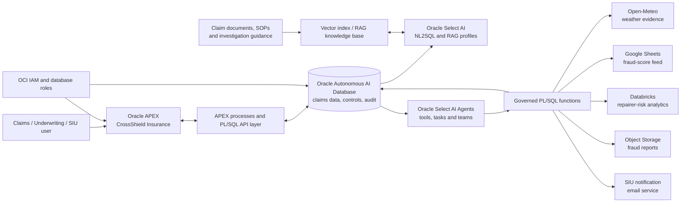
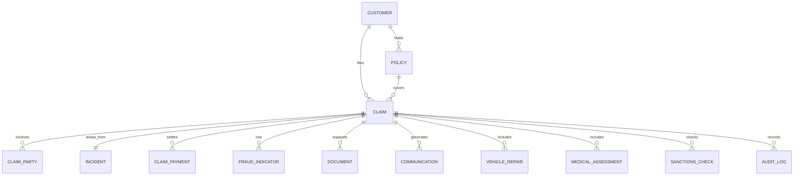
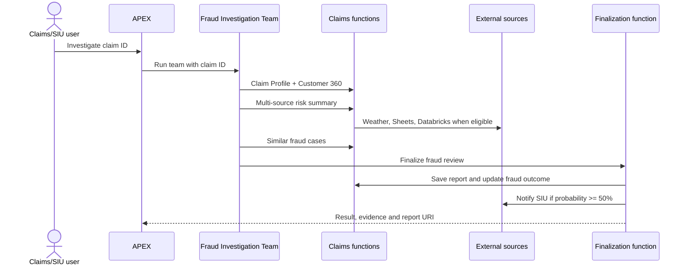

# CrossShield Insurance — High-Level Design

**Author:** Madhusudhan Rao  
**Version:** 0.01  
**Date:** 2026-08-28  
**Architecture:** Oracle APEX, Oracle Autonomous AI Database, Oracle Select AI / Select AI Agents, Oracle Cloud Infrastructure (OCI), Databricks, Open-Meteo, Google Sheets, Oracle Object Storage, email integration  
**Scope:** Proof of Validation (PoV) for claims operations, explainable fraud investigation and controlled claim maintenance

## 1. Executive summary

CrossShield Insurance is an AI-assisted claims-operations application. It gives claims, fraud and underwriting users a single place to review a claim, understand its customer and policy context, assess fraud risk from multiple sources, compare it with prior cases, and create an evidence-backed investigation report.

The solution uses Oracle APEX as the operational user experience and Oracle Autonomous AI Database as the transactional, analytics and agent-governance plane. Oracle Select AI Agents orchestrates deterministic, database-grounded tasks. The standard investigation team validates a claim, obtains multi-source risk evidence, identifies similar fraud cases and then creates the final probability report. Only the finalization path can persist a report, update the fraud outcome and notify the Special Investigations Unit (SIU). A separate maintenance team supports tightly constrained status and settlement updates.

The PoV is designed to demonstrate explainability, traceability and safe human supervision. It is not a replacement for a production policy administration system, claims core, enterprise fraud model or SIU case-management platform.

## 2. Problem statement

Claims staff commonly assemble evidence from policy, claimant, incident, repair, payment, document, weather, third-party and historical-case systems. The work is slow, inconsistent and difficult to audit. A high-risk claim can be missed, while legitimate claims may be delayed by unnecessary manual research.

CrossShield addresses this by presenting the claim record and a governed AI investigation workflow in the same application. The workflow is constrained to approved data functions and tool contracts, retains the source evidence behind each recommendation, and limits data changes to explicit, auditable functions.

## 3. Objectives and measurable outcomes

The project provides a trusted, human-supervised operating layer that:

- Presents a Customer 360 and claim view including policy, incident, parties, payments, documents and fraud indicators.
- Produces a rule-based fraud probability, risk level and reason-code evidence for a selected claim.
- Validates the result with contextual, weather, Google Sheets and Databricks repairer-risk evidence where available.
- Finds relevant historical fraud patterns and retrieves approved knowledge-base guidance.
- Generates, stores and links an explainable fraud investigation report.
- Routes suspicious claims to SIU and lets authorized users maintain only `CLAIM_STATUS` and `TOTAL_SETTLED`.

PoV success is measured by complete source evidence for an investigation, deterministic task execution, understandable risk rationale, report/audit traceability, and prevention of unauthorized claim-field changes. The PoV does not claim model accuracy, loss-ratio reduction or automated denial decisions.

## 4. Use-case scope

### 4.1 Claims and customer operations

Users can review claim details and related parties, list claims by status, see Customer 360 context, inspect payments and communications, and use the operations dashboard to prioritize high-risk claims. The Claim Maintenance Agent may update only a claim's settled amount and business status after first retrieving the existing record.

### 4.2 Fraud investigation

For a supplied claim ID, the Fraud Investigation Team runs four ordered activities:

1. Validate the claim, customer, policy, incident and available documents.
2. Build a multi-source risk summary using claim-derived, contextual, weather, Google Sheets and repairer evidence.
3. Identify similar past fraud cases.
4. Determine fraud probability, create and store an explainable report, update the fraud outcome and notify SIU when the configured threshold is met.

### 4.3 PoV boundaries and exclusions

The PoV uses a controlled claims dataset and approved external enrichment sources. It does not autonomously deny a claim, authorize payment, change coverage, alter policy data, undertake legal or regulatory decisions, or assert fraud as a fact. A fraud score is decision support and must be reviewed by an authorized claims or SIU user.

## 5. Target architecture

### Workload flow

1. A user selects a claim in the APEX dashboard or submits a claim-specific request through the AI control panel.
2. The application invokes a team appropriate to the request: fraud investigation, claim maintenance, RAG search or general assistance.
3. Select AI Agents invokes only the functions registered as tools for that task. The functions return structured JSON from authoritative relational data and approved external services.
4. The fraud team runs sequentially: claim analysis, multi-source validation, past-case similarity, and final probability/reporting.
5. Finalization stores the report, records the fraud score/flag and report URI against the claim, and sends SIU notification when fraud probability is 50% or above.
6. APEX renders the claim report, evidence, data-quality/error states and audit-facing outcome for user review.

## 6. Logical components

| Component | Responsibility |
|---|---|
| Oracle APEX CrossShield application | Operational home, Fraud Management dashboard, claim details, reports and AI Agent Control Panel. |
| APEX process / PL/SQL API layer | Validates request context, invokes approved AI teams or functions, and formats result data for the UI. |
| Autonomous AI Database | Owns the PoV claims domain, agent configuration, runtime configuration, audit records and report metadata. |
| Oracle Select AI | Provides governed NL2SQL against an explicit object list and RAG generation against the knowledge base. |
| Oracle Select AI Agents | Registers bounded tools, tasks, agents and sequential teams; enforces the intended workflow rather than open-ended tool use. |
| Fraud Investigation Agent | Coordinates claim evidence, risk validation, case similarity and final report generation. |
| Claim Maintenance Agent | Lists, views and makes narrowly controlled updates to claims. |
| RAG Knowledge Base Agent | Retrieves grounded answers and citations from the vector knowledge base only. |
| External integration functions | Retrieve weather, Google Sheets, Databricks and contextual evidence; store reports and issue notifications. |
| Observability and audit | Captures decision outcome, report URI, communication event and database audit records; agent/task history is available through the platform. |

## 7. Logical data model and source ownership

The PoV keeps core operational insurance records in Autonomous AI Database. External enrichment remains owned by its originating service and is retrieved by narrowly scoped functions. The database stores the final decision metadata and report reference; it does not create a second master for external providers.

### 7.1 Logical ERD

### 7.2 Source-system mapping

| Source | Mastered / supplied entities | Agent and UI use |
|---|---|---|
| Autonomous AI Database — CrossShield schema | `CUSTOMERS`, `POLICIES`, `CLAIMS`, `CLAIM_PARTIES`, `INCIDENTS`, `CLAIM_PAYMENTS`, `FRAUD_INDICATORS`, `DOCUMENTS`, `COMMUNICATIONS`, `VEHICLE_REPAIRS`, `MEDICAL_ASSESSMENTS`, `SANCTIONS_CHECKS`, `AUDIT_LOG` | Authoritative operational claim evidence, Customer 360, controlled updates and audit. |
| Databricks | Repairer fraud/risk score and analytical evidence | Corroborates repairer-related risk for eligible claims. |
| Google Sheets | Customer fraud-score feed | Provides an additional matched risk signal; matching and data quality are shown in the result. |
| Open-Meteo | Historic/location weather observations | Supports incident plausibility analysis based on customer city and incident date. |
| Object Storage | Generated fraud-report files | Retains the final rendered report and returns a report URI. |
| Document repository / vector table | Claim documents, investigation guidance, SOPs and knowledge articles | RAG-grounded responses with citations when content has been loaded. |

### 7.3 Key data rules

- `CLAIM_ID` is the primary investigation key and must be present for claim-specific agent work.
- Tool results retain claim identifiers and source/evidence states; missing or unavailable evidence is returned as an explicit status, not fabricated.
- `TOTAL_CLAIMED`, reserve, customer, policy, incident and document fields are read-only to the maintenance agent.
- Only `TOTAL_SETTLED` and `CLAIM_STATUS` are writable through the dedicated maintenance function.
- Fraud reporting updates occur through the deterministic finalization path, not from an arbitrary chat response.

## 8. Required data and integrations

| Integration / capability | Access pattern | Data and purpose | PoV control |
|---|---|---|---|
| Claim profile | Database function by claim ID or claim number | Claim, customer, policy, vehicle, incident, fraud indicators and documents | Structured JSON; no unbounded table access. |
| Customer 360 | Database function by customer ID or claim ID | Customer identity, policies, claims, payments and interactions | Read-only structured JSON. |
| Rule-based risk scoring | Database function by claim ID | Fraud probability, risk level, reason codes, reporting delay, prior claims, claim amount and document checks | Explainable score, not a denial decision. |
| Multi-source risk summary | Database orchestration function by claim ID | Combines claim score, contextual data, weather, Google Sheets and Databricks result | Returns explicit errors/empty evidence where a source is unavailable. |
| Similar fraud cases | Database function by claim ID | Relevant prior cases and similarity rationale | Read-only, claim-scoped result. |
| RAG knowledge base | Select AI RAG profile and vector index | SOPs, guidelines and approved document answers | Returns citations only when vector chunks are loaded. |
| Weather | HTTPS call to Open-Meteo | Weather context for claim city/date | Read-only enrichment; no confidential fields sent beyond required location/date. |
| Databricks | Configured service/API request | Repairer-fraud analytics | Token held in runtime configuration, never source code. |
| Google Sheets | Configured endpoint | Supplemental customer fraud score | URL in runtime configuration; input/output validation required. |
| Report and notification | Object Storage and email function | Fraud report URI and SIU communication record | Finalization function controls sequence and threshold. |

### 8.1 Select AI profiles and knowledge retrieval

The deployed design uses a Select AI NL2SQL profile for approved relational questions and a separate RAG profile backed by `FSI_HUB_VECTOR_INDEX_KB`. The knowledge base agent cannot update claims, create reports or send notifications. At PoV deployment the vector table may be empty; in that state it must state that no citations are available rather than manufacture a knowledge answer.

## 9. AI-agent design

### Implementation approach

The implementation uses four agents, bounded tools and seven tasks. Tasks explicitly identify their permitted tools and return compact JSON, which makes each stage testable and prevents an investigation agent from selecting unrelated actions.

| Team / agent | Tasks and responsibility | Write authority |
|---|---|---|
| `FSI_FRAUD_INVESTIGATION_TEAM` / `FSI_FRAUD_INVESTIGATION_AGENT` | Analyze claim data; validate multi-source risk; assess similar fraud; determine probability and report. Runs sequentially. | Final task only: report save, fraud outcome update and SIU notification. |
| `FSI_CLAIM_MAINTENANCE_TEAM` / `FSI_CLAIM_MAINTENANCE_AGENT` | List by status, view claim and parties, update settlement/status by claim ID. | `TOTAL_SETTLED` and `CLAIM_STATUS` only. |
| `FSI_RAG_KNOWLEDGE_BASE_TEAM` / `FSI_RAG_KNOWLEDGE_BASE_AGENT` | Search RAG knowledge base and return grounded answer/citations. | None. |
| `FSI_GENERIC_AI_TEAM` / `FSI_GENERIC_AI_AGENT` | General help for the control panel; directs claim-specific requests to provide a numeric claim ID. | None. |

### Fraud investigation sequence

## 10. Human experience and SPA mockup

The production experience is Oracle APEX rather than a separate React SPA. CrossShield presents a Redwood-styled operational interface with claims-focused pages.

| Experience area | Primary user value |
|---|---|
| Home / operational dashboard | High-level claim and fraud workload visibility. |
| Fraud Management | High-risk claims, indicators, active investigations, risk status and drill-down. |
| Claim Details | Claim, policy, customer, parties, financials, incident, document and risk evidence. |
| Fraud investigation report | Executive summary, insurance claim summary, Explainable AI, risk evidence, similar cases, document findings and recommendation. |
| AI Agent Control Panel | Guided natural-language entry point for investigation, maintenance, RAG and general help. |
| Audit/history surfaces | Report URI, communication outcomes, decision rationale and controlled-update traceability. |

The UI must distinguish authoritative facts, derived scores, external enrichment, missing source data and AI narrative. A fraud probability must never be rendered as a definitive fraud finding.

## 11. Governance, security and reliability

### 11.1 Access and data protection

- Use OCI IAM, APEX authentication/authorization schemes and database roles to apply least privilege.
- Keep external tokens and endpoints in `FSI_RUNTIME_CONFIG` or OCI-managed secret mechanisms; never embed them in client code or source-controlled SQL.
- Restrict Select AI NL2SQL to the approved profile object list and tasks to their declared tools.
- Escape and validate APEX-rendered values; protect against injection in user prompts, dynamic SQL and HTML output.
- Store report artefacts under controlled object-storage access and return only an authorized report URI.

### 11.2 Decision governance

- The rule-based score exposes reason codes and contributing metrics.
- External evidence is corroborative and may be absent, stale or unavailable; the report must identify this condition.
- A human investigator remains responsible for investigation, referral, denial, settlement and customer communication decisions.
- SIU notification at the 50% threshold is a triage/escalation workflow, not an automated accusation or adverse decision.

### 11.3 Reliability and observability

- Functions return structured success, not-found and error states so the UI can display a safe result.
- The finalization function is the authoritative, compact path for report creation, update and threshold-based notification, reducing partial orchestration outcomes.
- Persist report metadata, communication record and audit logs; retain source timestamps and correlation identifiers where integrations expose them.
- Monitor agent task failures, external-call latency/error rates, report-storage failures and notification delivery outcomes.
- Use idempotency or a correlation key for retried finalization/notification requests before a production rollout.

## 12. Delivery roadmap

| Phase | Outcome |
|---|---|
| 1. Foundation | Deploy claims schema dependencies, runtime configuration, OCI credential and Select AI profiles. |
| 2. Governed capabilities | Deploy/verify functions, bounded tools, tasks, agents and teams. Test each task with representative claim IDs. |
| 3. APEX operations | Complete dashboard, Fraud Management, claim detail, AI control panel and report-rendering experiences. |
| 4. Integration hardening | Configure Databricks token, Google Sheets URL, Object Storage and SIU email; implement health checks and test error paths. |
| 5. Knowledge and controls | Load approved knowledge chunks; validate citations, roles, retention, audit evidence and human review procedure. |
| 6. PoV evaluation | Measure traceability, task completion, source availability, user assessment time and investigation quality against a selected claim cohort. |

## 13. Acceptance criteria

- A user can retrieve a claim and Customer 360 context by claim ID without exposing unrelated records.
- The fraud team executes the four investigation stages in the documented order and returns evidence/error states for each.
- The final report includes claim summary, fraud probability, risk level, reason codes, multi-source evidence, similar-case evidence and recommended next actions.
- The system saves a successful report, records its URI and sends SIU notification only when the configured threshold is reached.
- Claim maintenance can list/view claims and changes no columns other than `TOTAL_SETTLED` and `CLAIM_STATUS`.
- The RAG agent returns citations when indexed content exists and clearly reports no-citation/no-content states otherwise.
- All sensitive integration configuration is externalized from code; authorized-role checks and audit records are demonstrable.
- Users can distinguish AI-supported recommendations from authoritative claim facts and can complete the required human review before consequential action.
