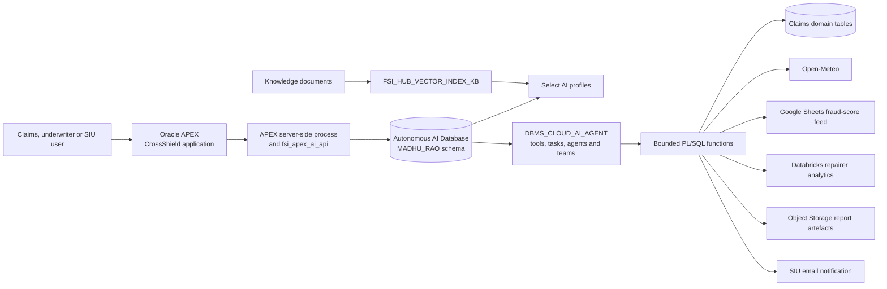
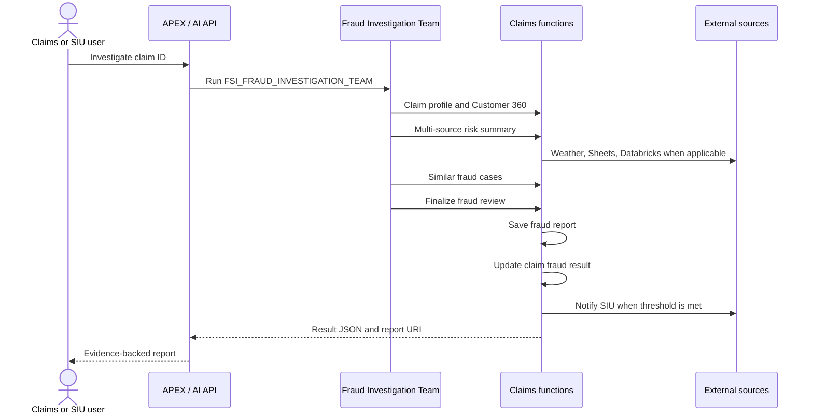
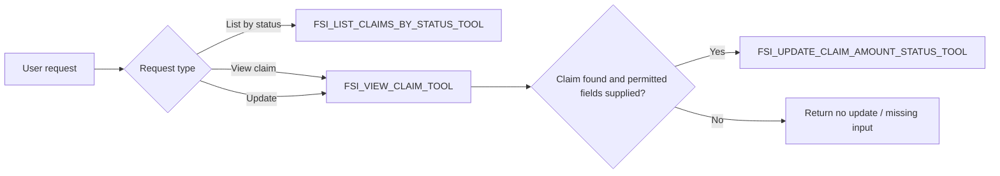
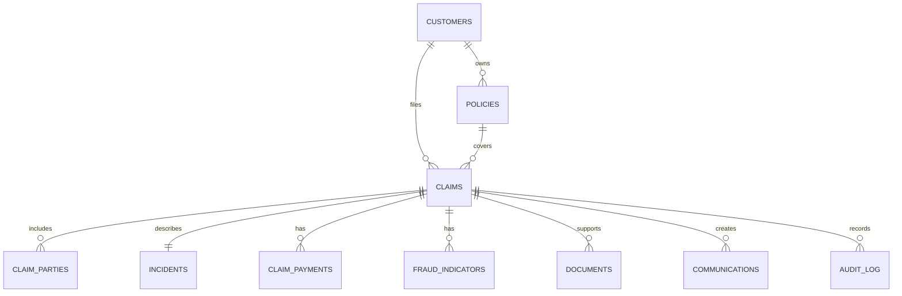

# CrossShield Insurance — Low-Level Design

**Author:** Madhusudhan Rao  
**Version:** 0.01 — implementation baseline  
**Date:** 2026-08-28  
**HLD baseline and source of truth:** `CrossShield_Insurance_HLD-v0.01.md`  
**Application baseline:** CrossShield Insurance Oracle APEX application and `AI_For_FS/deploy/madhu_rao` deployment scripts

## 1. Abstract

CrossShield Insurance is a human-supervised claims and fraud-investigation PoV. It provides claim and Customer 360 retrieval, rule-based fraud scoring, multi-source evidence validation, similar-case comparison, generated fraud reports, SIU notification and restricted claim maintenance.

Oracle APEX is the user experience. Oracle Autonomous AI Database hosts the operational PoV data, PL/SQL service functions, Select AI profiles and Select AI Agent configuration. Agents are deliberately bounded: they call only named tools backed by functions, use a supplied numeric `CLAIM_ID` for claim-specific work, and execute the fraud workflow in a fixed sequence. The finalization function owns the consequential steps of report persistence, fraud-outcome update and threshold-based SIU notification.

| HLD outcome | LLD implementation evidence |
|---|---|
| Explainable fraud assessment | `fsi_claim_risk_score` returns probability, risk level and reason codes; report output contains evidence and recommended next actions. |
| Multi-source corroboration | `fsi_validate_multi_source_risk_summary` combines claim, contextual, weather, Google Sheets and Databricks evidence. |
| Deterministic investigation path | `FSI_FRAUD_INVESTIGATION_TEAM` runs four named tasks sequentially. |
| Safe claim maintenance | `fsi_update_claim_amount_status` changes only `TOTAL_SETTLED` and `CLAIM_STATUS`. |
| Traceable escalation | `fsi_finalize_fraud_review` stores report data, updates the outcome and notifies SIU at probability >= 50%. |

## 2. Overall Architecture

| Technology | Role and boundary |
|---|---|
| Oracle APEX | CrossShield pages, dashboard, claim detail and AI control-panel interaction. It renders server-generated content and does not contain database/provider secrets. |
| Autonomous AI Database | Owns PoV core data, runtime settings, database functions, Select AI profiles, vector index and agent metadata. |
| `DBMS_CLOUD_AI` | Supplies NL2SQL and RAG generation through separately configured profiles. |
| `DBMS_CLOUD_AI_AGENT` | Registers the allowlisted tools, tasks, agents and teams; it is the AI workflow runtime. |
| PL/SQL functions/packages | Stable JSON contracts for claim retrieval, risk, enrichment, report storage, notification and controlled update. |
| OCI services / external endpoints | Supply credentials, report storage, weather, repairer analytics, Google Sheets enrichment and email delivery. |

### 2.1 Component responsibilities and provider configuration

| Component | Implementation responsibility | Explicit non-responsibility |
|---|---|---|
| APEX application | Display operational data; invoke server-side AI API; provide controlled navigation from Fraud Management to claim detail/report | Direct database connection from browser; browser-held secrets; autonomous claim decision |
| `fsi_apex_ai_api` | Extracts claim context, invokes approved teams and renders a structured Redwood-style fraud report | Arbitrary SQL, arbitrary tool names or unsupported factual content |
| `MADHU_RAO` schema | Claims data access, deterministic calculations, report/audit persistence and agent control plane | External-system master for weather, Databricks or Google Sheets data |
| Runtime configuration | `FSI_RUNTIME_CONFIG` holds non-secret endpoint settings and secret references/configuration values | Source-control storage for `DATABRICKS_TOKEN` or production Google Sheet URL |
| Fraud finalizer | One controlled end-to-end persistence path for report, fraud outcome and notification | Auto-denial, settlement approval or policy modification |
| RAG knowledge base | Grounded retrieval from `FSI_HUB_VECTOR_INDEX_KB` and its vector table | Claim update, report save or notification action |

The database deployment order is fixed:

1. `00_runtime_config.sql` creates runtime configuration/defaults.
2. `00_profiles.sql` creates Select AI profiles.
3. `01_weather.sql` deploys the weather package.
4. `02_functions.sql` and `02b_functions_remaining.sql` deploy functions.
5. `03_cleanup_ai_objects.sql` removes prior agent metadata.
6. `04_tools_tasks_agents.sql` creates tools, tasks and agents.
7. `05_teams.sql` creates agent teams.

## 3. Application

The CrossShield application is an Oracle APEX application rather than a React SPA. APEX invokes server-side PL/SQL and the agent runtime. Claim-specific conversations must contain a numeric claim identifier, such as `Investigate claim id 20`; the application does not use an LLM to infer a claim record from an ambiguous name.

### 3.1 Application implementation

| Application area | Implementation | Input / output contract |
|---|---|---|
| Fraud Management | APEX dashboard code reads `CLAIMS` and `FRAUD_INDICATORS`, lists high-risk claims and links to detailed claim pages | Claim ID, customer, type, status, score and indicator summary; user filter/pagination only |
| Claim detail | APEX page retrieves claim data/parties and can render AI investigation result | Claim ID is the context key; factual record is separated from derived report content |
| AI Agent Control Panel | `fsi_apex_ai_api` routes request to an approved team and formats report/assistant response | Request text + validated claim ID where required; no raw SQL/tool injection |
| Fraud report rendering | APEX renders report fragment in one `rw-report` container with mandatory executive and insurance-claim summary tables | Stored/report-generated HTML is constrained to the CrossShield report shape |
| Claim maintenance | Maintenance team lists by status, views a claim, or changes settlement/status after existence check | JSON: `p_claim_id`, `p_total_settled`, `p_status`; no other writable field |

### 3.2 Detailed runtime flows

#### 3.2.1 Fraud investigation

1. The API extracts and validates a numeric claim ID.
2. `FSI_ANALYZE_CLAIM_DATA_TASK` calls `FSI_CLAIM_PROFILE_TOOL` and `FSI_CUSTOMER_360_TOOL` only.
3. `FSI_VALIDATE_MULTI_SOURCE_RISK_TASK` calls the single aggregate risk-summary tool.
4. `FSI_ASSESS_PAST_FRAUD_SIMILARITY_TASK` calls the similar-cases tool only.
5. `FSI_DETERMINE_PROBABILITY_REPORT_TASK` calls the finalizer only. The finalizer saves/report-links the result, updates fraud information and sends notification according to the threshold.
6. The APEX report renderer shows the factual claim summary, Explainable AI, evidence, similarity, findings, recommendation and confidence. Confidence is rendered as the final fraud probability, not an unrelated certainty score.

#### 3.2.2 Claim maintenance

The update path first reads the claim. It can modify only `CLAIMS.TOTAL_SETTLED` and `CLAIMS.CLAIM_STATUS`; `TOTAL_CLAIMED`, reserve, fraud score/flag, policy, customer, incident and document information remain immutable through this interface.

#### 3.2.3 RAG and general assistance

The RAG team calls `FSI_RAG_KNOWLEDGE_BASE_SEARCH_TOOL` once for a user query and returns its structured result, including citations where indexed chunks exist. The generic team contains no tools and may answer general help questions only. It must request a numeric claim ID for claim-specific work and never invent claim data.

## 4. Data

### 4.1 Exact source-entity ownership and retrieval contracts

| Entity / source | Retrieval implementation | Required response data | Allowed use |
|---|---|---|---|
| `CLAIMS` | Claim-profile, view, scoring and maintenance functions | claim number/status/type, dates, claimed/settled/reserve values, fraud fields | Claim facts, score input, controlled status/settlement update |
| `CUSTOMERS`, `POLICIES` | Claim profile and Customer 360 functions | identity, policy/coverage and related claim context | Evidence validation and report summary |
| `CLAIM_PARTIES`, `INCIDENTS` | Claim profile/view functions | parties, vehicle/incident details | Claim validation and investigation narrative |
| `CLAIM_PAYMENTS`, `COMMUNICATIONS` | Customer 360 and report/notification functions | payment/interactions and delivery record | Customer context and audit trail |
| `FRAUD_INDICATORS` | Scoring/profile/context functions | indicator type, source and status | Reason-code/risk evidence |
| `DOCUMENTS` | Profile, scoring and RAG functions | document metadata, verification state and report artefacts | Evidence checks, RAG and report storage |
| `VEHICLE_REPAIRS`, `MEDICAL_ASSESSMENTS`, `SANCTIONS_CHECKS` | Contextual risk function | repair/medical/sanctions context where eligible | Multi-source evidence; absence retained explicitly |
| Databricks repairer data | `fsi_databricks_repairer_fraud_score` | repairer risk score, source/data quality status | Corroborative repairer evidence |
| Google Sheets | Third-party fraud function | matched customer fraud score and match status | Corroborative customer risk signal |
| Open-Meteo | `fsi_weather_anomaly` package / third-party function | location/date weather and anomaly result | Incident plausibility evidence |

All function responses are JSON and should include the request claim ID, status, evidence or error details. Source failure is represented as a returned error/empty result; it must not be replaced with fabricated evidence.

### 4.2 Physical database model

| Table | Key columns | Purpose and integrity |
|---|---|---|
| `CUSTOMERS` | `CUSTOMER_ID` | Customer master; referenced by policies and claims. |
| `POLICIES` | `POLICY_ID`, `CUSTOMER_ID` | Policy/coverage master; must resolve to the claimant/claim context. |
| `CLAIMS` | `CLAIM_ID`, `CLAIM_NUMBER`, `CUSTOMER_ID`, `POLICY_ID` | Primary operational record; owns status, amounts, fraud score/flag and final report reference. |
| `CLAIM_PARTIES` | party key, `CLAIM_ID` | Claimant, insured and third-party context linked to claim. |
| `INCIDENTS` | incident key, `CLAIM_ID` | Incident date/location/details used in fraud and weather context. |
| `CLAIM_PAYMENTS` | payment key, `CLAIM_ID` | Payment/settlement context. |
| `FRAUD_INDICATORS` | indicator key, `CLAIM_ID` | Evidence signals used by scoring and investigation. |
| `DOCUMENTS` | document key, `ENTITY_TYPE`, `ENTITY_ID` | Claim documents and generated report metadata. |
| `COMMUNICATIONS` | communication key, claim/entity reference | Notification records, including SIU delivery outcome. |
| `AUDIT_LOG` | audit key, actor/time/entity reference | Operational audit evidence. |
| `FSI_RUNTIME_CONFIG` | configuration key | Runtime endpoints/configuration; secrets are excluded from source control. |

The logical relationships are:

### 4.3 Select AI profile and vector implementation

| Object | Purpose | Control |
|---|---|---|
| `fsi_select_ai_hub_nl2sql` | NL2SQL profile for approved CrossShield relational questions | Used only by its permitted SQL/agent context; no arbitrary object access. |
| `FSI_SELECT_AI_RAG_KB_PROFILE` | RAG profile for knowledge-base questions | Used only by RAG tool/task. |
| `FSI_HUB_VECTOR_INDEX_KB` | Vector index underpinning RAG | Requires approved/documented chunk load before citation results exist. |
| `FSI_HUB_VECTOR_INDEX_KB$VECTAB` | Platform vector table | May be empty after deployment; that is a valid `no knowledge data` state. |

## 5. Agents

### 5.1 Detailed tool contracts and output

| Tool | Function / input | Output and guard |
|---|---|---|
| `FSI_CLAIM_PROFILE_TOOL` | `fsi_claim_profile(p_claim_id, p_claim_number)` | Complete claim/customer/policy/vehicle/incident/indicator/document JSON; read-only. |
| `FSI_CUSTOMER_360_TOOL` | `fsi_customer_360(p_customer_id, p_claim_id)` | Customer identity, policies, claims, payments and interactions; read-only. |
| `FSI_RISK_SCORE_TOOL` | `fsi_claim_risk_score(p_claim_id)` | `fraud_probability`, `risk_level`, reason codes and metrics. |
| `FSI_VALIDATE_MULTI_SOURCE_RISK_SUMMARY_TOOL` | `fsi_validate_multi_source_risk_summary(p_claim_id)` | Claim summary, risk score, weather, Google Sheets, Databricks, contextual evidence, potential/risk level and errors. |
| `FSI_SIMILAR_CASES_TOOL` | `fsi_similar_fraud_cases(p_claim_id)` | Similar cases, similarity evidence and next actions; read-only. |
| `FSI_RAG_KNOWLEDGE_BASE_SEARCH_TOOL` | `fsi_rag_knowledge_base_search(p_query)` | Answer, vector/index status, chunk count and citations/error. |
| `FSI_LIST_CLAIMS_BY_STATUS_TOOL` | `fsi_list_claims_by_status(p_status, p_limit)` | Capped status-filtered claim list; no update. |
| `FSI_VIEW_CLAIM_TOOL` | `fsi_view_claim(p_claim_id)` | `CLAIMS` record plus `CLAIM_PARTIES`; read-only. |
| `FSI_UPDATE_CLAIM_AMOUNT_STATUS_TOOL` | `fsi_update_claim_amount_status(p_claim_id, p_total_settled, p_status)` | Before/after controlled update. Blocks all other columns. |
| `FSI_FINALIZE_FRAUD_REVIEW_TOOL` | `fsi_finalize_fraud_review(p_claim_id)` | Final JSON with fraud potential, evidence, errors, next actions and report URI; owns save/update/notification sequence. |
| `FSI_EMAIL_FRAUD_REPORT_TOOL` | `fsi_send_fraud_notification(...)` | Sends report to SIU; only permitted as part of finalization orchestration. |

### 5.2 Agent execution rules

| Agent/team | Task order and execution rule |
|---|---|
| `FSI_FRAUD_INVESTIGATION_TEAM` | Executes `FSI_ANALYZE_CLAIM_DATA_TASK`, `FSI_VALIDATE_MULTI_SOURCE_RISK_TASK`, `FSI_ASSESS_PAST_FRAUD_SIMILARITY_TASK`, then `FSI_DETERMINE_PROBABILITY_REPORT_TASK`, sequentially. |
| Analyze task | Calls profile then Customer 360 only; returns compact JSON or `SKIPPED_MAINTENANCE_REQUEST`. |
| Multi-source task | Calls aggregate validation tool exactly once; preserves empty arrays/errors for unavailable repair/medical evidence. |
| Similarity task | Calls similar-cases tool exactly once; returns top matches and evidence. |
| Determine/report task | Calls finalizer exactly once; does not separately save, update or email. |
| `FSI_CLAIM_MAINTENANCE_TEAM` | Routes list/view/update prompts to bounded tools. Updates require claim ID, read-before-write and an allowed field/value. |
| `FSI_RAG_KNOWLEDGE_BASE_TEAM` | Search-only task; no claim updates, reports or notifications. |
| `FSI_GENERIC_AI_TEAM` | Has no tools and cannot query/infer claim data. |

The agent runtime must reject any unlisted tool invocation, arbitrary SQL, client-provided function name or raw external endpoint. It records task, tool, profile/configuration version, claim context, status and redacted input/output audit data according to retention policy.

## 6. UI

| Screen | Required behavior | Error/empty behavior |
|---|---|---|
| Home | Present CrossShield navigation and high-level operating indicators | Do not imply a data refresh when source/region data is unavailable. |
| Fraud Management | Show high-risk claims, fraud indicators, status filter and link to claim detail | State that no high-risk claims match the selected status rather than rendering empty data as zero risk. |
| Claim Detail | Present authoritative claim, party and financial fields separately from AI-derived evidence | Render missing/unauthorized fields as unavailable; do not create derived values. |
| Fraud report | Render Executive Summary and tabular Summary of Insurance Claim; include Explainable AI, evidence, similar cases, findings and recommendation | Clearly show source error or no-evidence condition. |
| AI Agent Control Panel | Accept supported prompts, guide user to provide claim ID, display task/report result | Reject unsupported or ambiguous claim request safely. |
| Maintenance view | List/view claim then controlled settlement/status update | No update when claim is not found or only prohibited fields are provided. |

The report renderer must use authoritative fields for Claim ID, claim number, customer, claim type/status, reported date, claimed/reserve/settled amounts, fraud score and flag. It must not label a known authoritative value as “Data Error.”

## 7. Governance, security and reliability

| Control | Implementation and test assertion |
|---|---|
| Least privilege | Grant execution only on the required packages/functions and agent objects; APEX users receive application roles rather than direct table DML. |
| Runtime secrets | Configure `DATABRICKS_TOKEN` and `GOOGLE_SHEET_URL` after deployment through protected runtime configuration/secrets; do not commit credentials. |
| Prompt/tool control | Task instructions name exact tools and parameter JSON. Invalid tool names/arguments are rejected. |
| Data minimization | Tool results return only the claim-scoped fields needed by a task. External enrichment receives only necessary request context. |
| Controlled writes | Maintenance updates two permitted claim columns. Finalizer is the only workflow path that performs fraud outcome/report/notification actions. |
| Explainability | Fraud probability derives from declared rule-based signals and returns reason codes; third-party data is labelled supplemental. |
| Auditability | Persist report URI, communication record and audit rows; retain tool/task/correlation information where platform facilities permit. |
| Fault handling | Return JSON status/errors from functions; missing enrichment blocks unsupported claims rather than generating a false result. |
| Notification safety | SIU email occurs at the defined threshold and is an escalation signal, not a determination of fraud. |

### 7.1 Security test cases

1. A user without fraud/claim authority cannot invoke investigation or maintenance functions through APEX.
2. A maintenance request attempting to change `TOTAL_CLAIMED`, `RESERVE_AMOUNT`, `FRAUD_FLAG` or another prohibited field is rejected and leaves the record unchanged.
3. A non-numeric or missing claim ID causes no claim lookup, update, report save or notification.
4. A failed Databricks, Google Sheets or weather call is rendered as unavailable/error evidence, not a synthetic positive/negative signal.
5. A RAG request with no indexed chunks returns no citations and does not claim that an internal policy was found.
6. Finalization sends SIU notification only at/above the configured probability threshold and produces auditable report/update outcomes.

## 8. Appendixes

### 8.1 Delivery and acceptance

| Delivery item | Acceptance evidence |
|---|---|
| Database deployment | Terraform applies the schema/data SQL sources from `modules/provisioner`; `verify.sql` confirms runtime objects. |
| Profiles/agents | Two profiles, expected tools/tasks/agents/teams exist and each isolated task can run against an authorized sample claim. |
| Fraud investigation | Final report contains evidence sections and a report URI; final output has the documented JSON keys. |
| Maintenance | List/view works; update test proves only settlement/status change. |
| External services | Configured test calls demonstrate success plus unavailable-source response handling. |
| RAG | Approved test chunks return citations; empty-index test returns a safe no-content state. |

### 8.2 Observability and acceptance evidence

The operational dashboard should monitor agent-run status, per-tool failures, APEX error events, external-call latency, report-store success/failure, SIU notification delivery, empty RAG state, and write audit outcomes. Each investigation should be traceable by claim ID, report URI, request/agent run identifier and time.

### 8.3 HLD-to-LLD requirement coverage matrix

| HLD requirement | LLD implementation location |
|---|---|
| APEX claims and fraud user experience | Sections 3 and 6 |
| Autonomous Database decision/control plane | Sections 2 and 4 |
| Explainable, multi-source fraud analysis | Sections 3.2.1, 4.1 and 5.1 |
| Human-supervised consequential action | Sections 3.2.2 and 7 |
| RAG-grounded knowledge support | Sections 3.2.3 and 4.3 |
| Security, audit and reliability | Section 7 |

### 8.4 Acronyms

| Acronym | Meaning |
|---|---|
| ADB | Oracle Autonomous Database |
| APEX | Oracle Application Express |
| OCI | Oracle Cloud Infrastructure |
| RAG | Retrieval-Augmented Generation |
| SIU | Special Investigations Unit |
| UI | User Interface |
